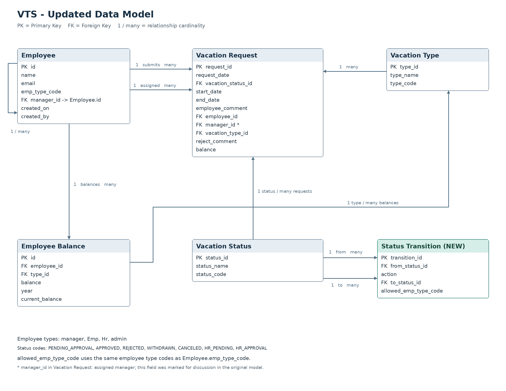
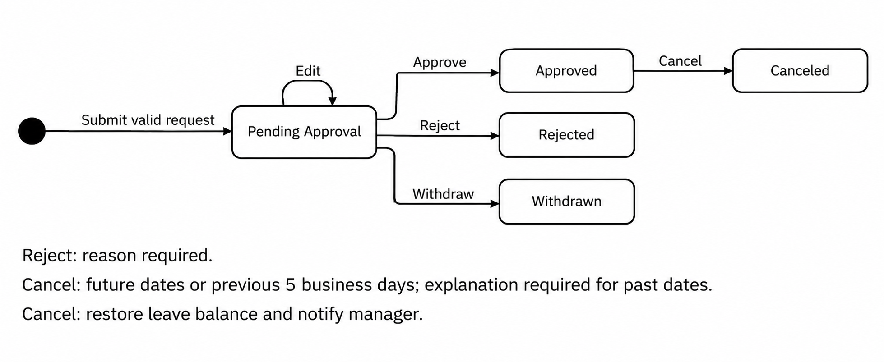

# VTS — Session 2 Tasks

## 1. Requests UI
### Employee View
### Manager View

## 2. Supporting New Statuses

### HR_Pending and HR_Approval

Add `HR_Pending` and `HR_Approval` to the existing **Vacation Status** table without changing existing status IDs.

### Required Changes

Add a **Status Transition** table with:

- From Status
- Action
- To Status
- Allowed Role

The application reads transitions and allowed roles from the database instead of hardcoding them.

| From Status | Action | To Status | Allowed Role |
|---|---|---|---|
| Pending Approval | Approve | HR_Pending | Manager |
| HR_Pending | Approve | HR_Approval | HR |
| HR_Pending | Reject | Rejected | HR |

Once this configuration is supported, these stages can be added by updating the database without changing the code.

### Updated ERD



## 3. Pseudocode

### Requests UI

```text
BEGIN
    employee = GET current employee
    DISPLAY employee's requests and leave balances

    IF employee is a manager THEN
        DISPLAY subordinate requests pending approval
    END IF

    WHEN a request is selected
        DISPLAY request details
        DISPLAY allowed actions based on status and employee permissions
END
```

### Supporting New Statuses

```text
FUNCTION processAction(requestId, action, currentEmployee)
    request = GET request by requestId

    transition = FIND transition WHERE
        From Status = request.status
        AND Action = action
        AND Allowed Role matches currentEmployee's role

    IF transition is not found THEN
        RETURN error
    END IF

    CHECK currentEmployee has permission to act on this request

    IF permission is denied THEN
        RETURN error
    END IF

    UPDATE request.status TO transition.To Status
    SAVE request
    RETURN success
END FUNCTION
```

## 4. Request State Machine Diagram



## 5. Main Flow — Submit New Request

### Sequence Diagram


### Use Case Diagram


## 6. Alternate Flow — Withdraw Request

### Flowchart

Start
→ Display employee requests
→ Select a Pending Approval request
→ Ask for withdrawal confirmation
→ Confirm?
  - No → Keep request unchanged → End
  - Yes → Change status to Withdrawn
        → Remove request from the manager's pending approvals
        → Notify manager by email
        → End

### Pseudocode

    FUNCTION withdrawRequest(requestId, employeeId, confirmed)
        request = GET request by requestId

        IF request.employee_id != employeeId THEN
            RETURN error
        END IF

        IF request.status != PENDING_APPROVAL THEN
            RETURN error
        END IF

        IF confirmed = false THEN
            RETURN without changes
        END IF

        transition = GET allowed transition for:
            request.status, WITHDRAW, employee's type

        IF transition is not found THEN
            RETURN error
        END IF

        UPDATE request.vacation_status_id TO transition.to_status_id
        SAVE request
        SEND notification email to manager

        RETURN success
    END FUNCTION

### Sequence Diagram


### Database Changes

No new tables or columns are required.

Ensure WITHDRAWN exists in Vacation Status and add this transition:

| From Status | Action | To Status | Allowed Type |
|---|---|---|---|
| PENDING_APPROVAL | WITHDRAW | WITHDRAWN | Emp |

The manager's pending approvals list only displays requests with status PENDING_APPROVAL, so withdrawn requests no longer appear.

The request remains stored in Vacation Request.

## 7. Alternate Flow — Cancel Approved Request

### Flowchart

Start
→ Select an Approved request
→ Check vacation dates
  - Not in the future or previous 5 business days → Display error → End
  - Future → Ask for confirmation
  - Previous 5 business days → Ask for confirmation and explanation
→ Confirm?
  - No → Keep request unchanged → End
  - Yes → Validate required information
        → Change status to Canceled
        → Restore leave balance
        → Notify manager by email
        → Display updated home page
        → End

### Pseudocode

```text
FUNCTION cancelRequest(requestId, employeeId, confirmed, explanation)
    request = GET request by requestId

    IF request.employee_id != employeeId THEN
        RETURN error
    END IF

    IF request.status != APPROVED THEN
        RETURN error
    END IF

    IF request is not in the future or previous 5 business days THEN
        RETURN error
    END IF

    IF confirmed = false THEN
        RETURN without changes
    END IF

    IF request is in the past AND explanation is empty THEN
        RETURN error
    END IF

    transition = GET allowed transition for:
        request.status, CANCEL, employee's type

    IF transition is not found THEN
        RETURN error
    END IF

    BEGIN TRANSACTION
        UPDATE request.vacation_status_id TO transition.to_status_id
        SAVE cancellation explanation
        RESTORE leave allowance used by the request
        SAVE changes
    COMMIT

    SEND notification email to manager
    RETURN updated requests and balances
END FUNCTION
```

### Sequence Diagram


### Database Changes

Add cancellation_explanation to Vacation Request.

Ensure CANCELED exists in Vacation Status and add this transition:

| From Status | Action | To Status | Allowed Type |
|---|---|---|---|
| APPROVED | CANCEL | CANCELED | Emp |

Update the corresponding Employee Balance.current_balance when cancellation succeeds.

## 8. Alternate Flow — Edit Pending Request

### Flowchart

Start
→ Select a Pending Approval request
→ Display editable request
→ Employee action?
  - Withdraw → Follow Withdraw Request flow → End
  - Edit → Change title, comments, or dates
         → Submit changes
         → Validate changes
           - Invalid → Display errors → Return to editing
           - Valid → Save changes
                   → Keep status Pending Approval
                   → Display home page
                   → End

### Pseudocode

```text
FUNCTION editPendingRequest(requestId, employeeId, changes)
    request = GET request by requestId

    IF request.employee_id != employeeId THEN
        RETURN error
    END IF

    IF request.status != PENDING_APPROVAL THEN
        RETURN error
    END IF

    transition = GET allowed transition for:
        request.status, EDIT, employee's type

    IF transition is not found THEN
        RETURN error
    END IF

    VALIDATE changes against company and location policies

    IF changes are invalid THEN
        RETURN editing page with errors
    END IF

    UPDATE request title, comments, and dates
    UPDATE request.vacation_status_id TO transition.to_status_id
    SAVE request

    RETURN home page
END FUNCTION
```

If the employee selects withdrawal, follow the Withdraw Request flow.

### Sequence Diagram


### Database Changes

Add title to Vacation Request because the use case allows editing it.

Use employee_comment for comments and start_date/end_date for dates.

Add this transition:

| From Status | Action | To Status | Allowed Type |
|---|---|---|---|
| PENDING_APPROVAL | EDIT | PENDING_APPROVAL | Emp |

No new tables are required for this flow.

The source also mentions Delete, but does not explain its behavior. No physical deletion is assumed.
